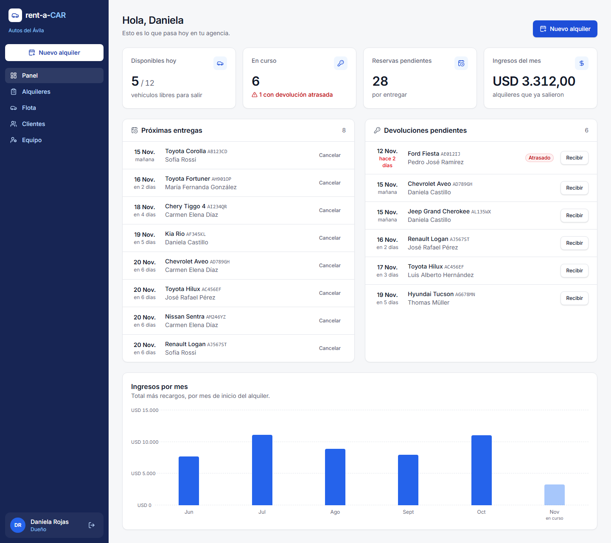

# rent-a-CAR

[](https://github.com/OWNER/rent-a-CAR/actions/workflows/ci.yml)

**Gestión de alquiler de vehículos multi-agencia**: flota, clientes, reservas y métricas para agencias pequeñas.
Las dobles reservas son **imposibles por diseño**: PostgreSQL las rechaza de forma atómica, incluso con peticiones simultáneas.

🇬🇧 [Read in English](README.md)



> **Pruébalo en local con un comando:** `docker compose up --build` → abre http://localhost:8080 y pulsa
> **«Demo como dueño»**. Se crea sola una agencia de demostración con 6 meses de historial.

## Qué problema resuelve

Muchas agencias pequeñas llevan sus reservas en cuadernos, hojas de cálculo o WhatsApp. El error más caro en ese
modelo es la **doble reserva**: prometer el mismo carro a dos clientes en fechas que se cruzan. Este proyecto hace
que ese error sea imposible, no solo improbable, y le da al mostrador una vista clara de qué entregar, qué debe
volver y qué está atrasado.

## Lo más interesante técnicamente

| Decisión | Por qué importa |
|---|---|
| **El anti-solapamiento vive en PostgreSQL** (`EXCLUDE USING gist` sobre `daterange`) | Es atómico. Una prueba lanza 8 peticiones simultáneas por el mismo carro y comprueba que gana exactamente una. |
| **Multi-tenant con Row Level Security** + filtro explícito en el código | Dos candados independientes. La API usa un rol restringido, porque un superusuario se salta RLS sin avisar. |
| **Claves foráneas compuestas** `(tenant_id, vehicle_id)` | Una reserva no puede apuntar a un vehículo de otra agencia. |
| **Reglas de negocio puras** (`backend/app/domain/`) | Precios, recargos y ciclo de vida se prueban sin framework ni base de datos. |
| **Dinero con `Decimal` de punta a punta** | La API envía `"40.00"` como texto y el frontend calcula en céntimos enteros. |
| **Seguridad desde el diseño** | Argon2id, JWT de vida corta, rol leído de la BD en cada petición, límite de intentos de login, auditoría solo-añadir. |
| **Compromisos documentados** | Cada decisión explica qué se sacrificó: [arquitectura y decisiones](docs/01-arquitectura-y-decisiones.md), [deuda técnica](docs/04-roadmap.md#deuda-técnica-conocida). |

## Funcionalidades

- **Panel**: disponibles hoy, alquileres en curso (con alerta de atrasos), reservas por entregar, ingresos del mes, gráfico de 6 meses y agenda de entregas y devoluciones con acciones en un clic.
- **Nuevo alquiler**: fechas → solo los vehículos libres en todo el periodo → cliente (o alta rápida) → confirmar. Si otra persona reserva ese carro mientras tanto, la API responde `409` y la lista se actualiza.
- **Ciclo de vida**: `reservado → en curso → devuelto` o `reservado → cancelado`. No se entrega antes de la fecha reservada; los retrasos generan recargo automático.
- **Flota y clientes**: búsqueda, filtros, paginación, alta y edición; borrar es solo del dueño, y lo que tiene historial no se borra (los vehículos se dan de baja).
- **Reglas de flota**: un vehículo con reservas pendientes no pasa a taller, y uno con la devolución atrasada no se ofrece como disponible.
- **Equipo**: el dueño crea agentes y puede desactivarlos; la sesión abierta del usuario desactivado deja de funcionar al instante.
- **Interfaz responsive y accesible**: diálogos nativos usables con teclado, formularios etiquetados y versión en tabla del gráfico para lectores de pantalla.

## Cómo ejecutarlo

```bash
docker compose up --build
```

| Servicio | URL |
|---|---|
| Panel web | http://localhost:8080 (demo: `demo@rentacar.dev` / `demo-rentacar`) |
| API (Swagger) | http://localhost:8000/docs |
| PostgreSQL | `localhost:5433` |

Desarrollo sin Docker para la app, pruebas y API: ver la [versión en inglés](README.md#running-it) (los comandos son los mismos).

## Pruebas

- **Backend** (`cd backend && pytest`): 66 pruebas. Las de integración crean una base PostgreSQL **temporal**, aplican las migraciones reales y llaman a la API con un **rol restringido** para que RLS se aplique de verdad.
- **Esquema SQL** (`scripts/test_schema.sh`): 12 garantías comprobadas directamente en SQL.
- **Frontend** (`cd frontend && npm test`): dinero en céntimos, fechas sin desfase de zona horaria, mensajes de error, formulario de login.
- **CI**: todo lo anterior, más lint y tipos, en GitHub Actions en cada *push* y contra un PostgreSQL real.

## Documentación

1. [Arquitectura y decisiones](docs/01-arquitectura-y-decisiones.md)
2. [Modelo de datos](docs/02-modelo-de-datos.md)
3. [Despliegue gratuito](docs/03-despliegue-gratuito.md)
4. [Roadmap y deuda técnica](docs/04-roadmap.md)
