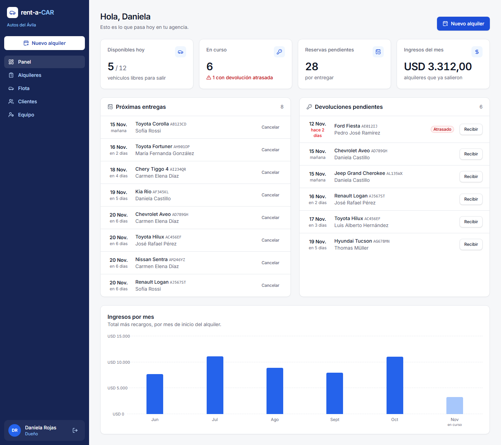
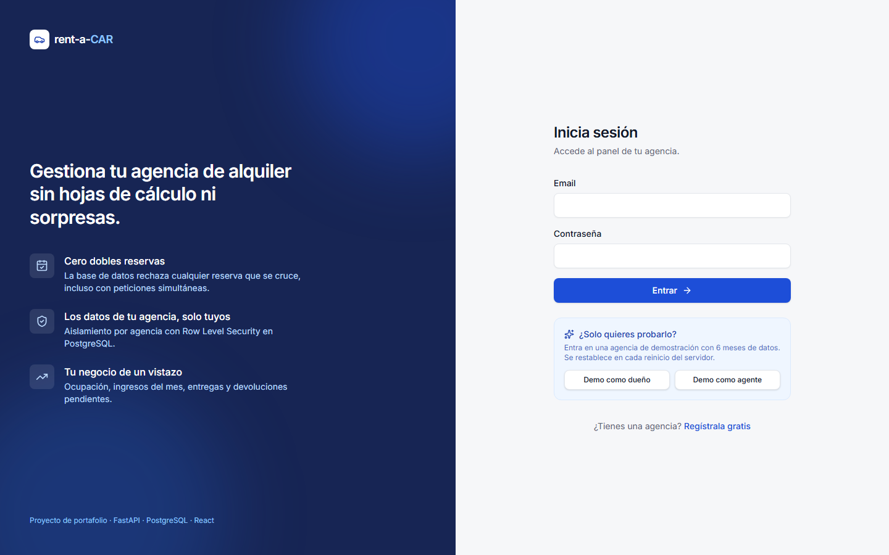
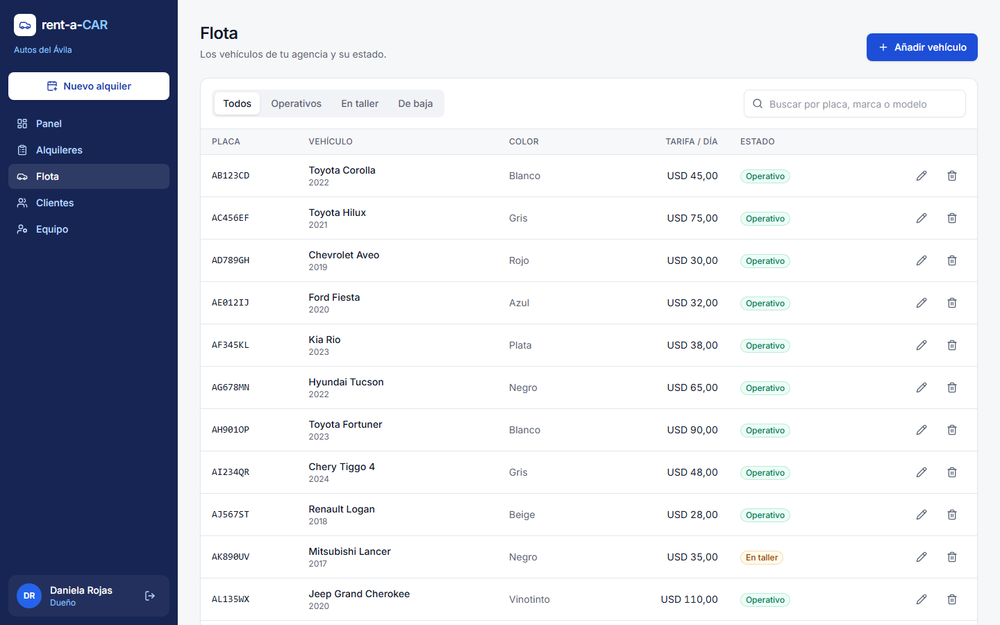
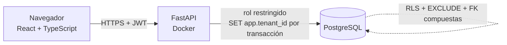

# rent-a-CAR

[](https://github.com/williamfloress/rentacar_mgta/actions/workflows/ci.yml)


**Aplicación web para que una agencia de alquiler de autos gestione su flota, sus clientes y sus reservas.**
Muestra qué entregar hoy, qué debe volver y qué está atrasado, calcula precios y recargos, y resume los ingresos.
Cada agencia accede únicamente a sus propios datos.

🇬🇧 [Read in English](README.en.md)



> **Demo en vivo:** https://rent-a-car-web.onrender.com
> Pulsa **«Demo como dueño»**. Está en un plan gratuito: la primera carga puede tardar hasta un minuto.
>
> **En local con un comando:** `docker compose up --build` → http://localhost:8080

---

## El problema

Muchas agencias pequeñas e independientes llevan sus reservas en cuadernos, hojas de cálculo o WhatsApp. El error más
caro en ese modelo es la **doble reserva**: prometer el mismo carro a dos clientes en fechas que se cruzan. Este
proyecto hace que ese error sea imposible, no solo improbable, y le da al mostrador una vista clara de qué entregar,
qué debe volver y qué está atrasado.

## Lo más interesante técnicamente

| Decisión | Por qué importa |
|---|---|
| **El anti-solapamiento vive en PostgreSQL** (`EXCLUDE USING gist` sobre un `daterange`) | Es atómico: ni dos peticiones simultáneas ni un bug en la app pueden crear una doble reserva. Una prueba lanza 8 peticiones a la vez por el mismo carro y comprueba que gana exactamente una. |
| **Multi-tenant con Row Level Security** + filtro explícito en el código | Dos candados independientes: aunque falle uno, una agencia no ve datos de otra. La API se conecta con un rol restringido, porque un superusuario se salta RLS sin avisar. |
| **Claves foráneas compuestas** `(tenant_id, vehicle_id)` | Una reserva no puede apuntar a un vehículo de otra agencia, ni por error ni por ataque. |
| **Reglas de negocio puras** (`backend/app/domain/`) | Precios, recargos y ciclo de vida no importan el framework y se prueban en milisegundos. |
| **Dinero con `Decimal` de punta a punta** | La API envía `"40.00"` como texto y el frontend calcula en céntimos enteros. Sin sorpresas de `0.1 + 0.2`. |
| **Seguridad desde el diseño** | Argon2id, JWT de vida corta, rol leído de la BD en cada petición (desactivar a alguien surte efecto al instante), límite de intentos de login, auditoría solo-añadir, sin filtrar qué emails existen. |
| **Compromisos documentados** | Cada decisión explica qué se sacrificó. Ver [arquitectura y decisiones](docs/01-arquitectura-y-decisiones.md) y la [deuda técnica conocida](docs/04-roadmap.md#deuda-técnica-conocida). |

## Funcionalidades

- **Panel**: vehículos disponibles hoy, alquileres en curso (con alerta de atrasos), reservas por entregar, ingresos del mes, gráfico de 6 meses y agenda de entregas y devoluciones con acciones en un clic.
- **Nuevo alquiler**: fechas → solo los vehículos libres en todo el periodo → cliente (o alta rápida) → confirmar. El total se calcula en vivo; si otra persona reserva ese carro mientras tanto, la API responde `409` y la lista se actualiza.
- **Ciclo de vida**: `reservado → en curso → devuelto` o `reservado → cancelado`, impuesto por una máquina de estados. No se entrega antes de la fecha reservada y los retrasos generan recargo automático.
- **Flota y clientes**: búsqueda, filtros, paginación, alta y edición. Borrar es solo del dueño, y lo que tiene historial no se borra (los vehículos se dan de baja).
- **Reglas de flota**: un vehículo con reservas pendientes no pasa a taller, y uno con la devolución atrasada no se ofrece como disponible.
- **Equipo**: el dueño crea agentes y puede desactivarlos; la sesión abierta del usuario desactivado deja de funcionar al instante.
- **Interfaz responsive y accesible**: diálogos nativos usables con teclado, formularios etiquetados, versión en tabla del gráfico para lectores de pantalla, funciona en móvil.

| | |
|---|---|
|  |  |
|  |  |

## Arquitectura



| Capa | Tecnologías |
|---|---|
| Backend | Python 3.13, FastAPI, SQLAlchemy 2, Alembic, Pydantic v2, Argon2, PyJWT |
| Base de datos | PostgreSQL 16: restricciones `EXCLUDE`, Row Level Security, FK compuestas, triggers |
| Frontend | React 19, TypeScript (estricto), Vite, Tailwind CSS v4, TanStack Query, React Hook Form + Zod |
| Calidad | pytest (unitarias + integración contra PostgreSQL real), pruebas SQL del esquema, Vitest + Testing Library, Ruff, ESLint |
| Entrega | Docker (multi-etapa, usuario sin privilegios), docker compose, GitHub Actions, Blueprint de Render |

```
rent-a-CAR/
├── backend/
│   ├── app/
│   │   ├── domain/          # reglas puras: precios, máquina de estados, periodos
│   │   ├── routers/         # endpoints HTTP
│   │   ├── availability.py  # única definición de "¿está ocupado este carro?"
│   │   ├── database.py      # conexión + contexto de agencia por transacción (RLS)
│   │   ├── seed.py          # agencia de demostración con 6 meses de datos
│   │   └── …
│   ├── migrations/          # Alembic + esquema SQL escrito a mano (fuente única de verdad)
│   └── tests/               # unitarias + integration/ (PostgreSQL real) + sql/
├── frontend/src/
│   ├── pages/               # panel, nuevo alquiler, alquileres, flota, clientes, equipo, acceso
│   ├── components/          # piezas de interfaz, layout, gráfico
│   ├── api/hooks.ts         # acceso a datos (TanStack Query)
│   └── lib/                 # cliente API, dinero en céntimos, fechas sin desfase horario
├── docs/                    # decisiones, modelo de datos, despliegue, roadmap
├── docker-compose.yml       # todo el sistema con un comando
└── render.yaml              # despliegue como código
```

## Cómo ejecutarlo

### Todo con Docker (recomendado)

```bash
docker compose up --build
```

| Servicio | URL |
|---|---|
| Panel web | http://localhost:8080 — demo: `demo@rentacar.dev` / `demo-rentacar` (dueño) o `agente@rentacar.dev` (agente) |
| API (Swagger) | http://localhost:8000/docs |
| PostgreSQL | `localhost:5433` (5433 para no chocar con un PostgreSQL local) |

### Desarrollo sin Docker para la app

```bash
docker compose up -d db                      # solo la base de datos

cd backend
python -m venv .venv && source .venv/bin/activate   # Windows: .venv\Scripts\activate
pip install -r requirements.lock -r requirements-dev.txt
cp ../.env.example .env
alembic upgrade head && python -m app.seed
uvicorn app.main:app --reload

cd ../frontend
npm install
npm run dev                                  # http://localhost:5173
```

## Pruebas

| Suite | Comando | Qué cubre |
|---|---|---|
| Backend: unitarias + integración | `cd backend && pytest` | 66 pruebas. Las de integración crean una **base PostgreSQL temporal**, aplican las migraciones reales con Alembic y llaman a la API con un **rol restringido** para que RLS se aplique de verdad. Incluyen la prueba de concurrencia, el aislamiento entre agencias, roles, ciclo de vida, recargos, paginación y límite de intentos. |
| Garantías del esquema SQL | `PGHOST=localhost PGPORT=5433 PGUSER=rentacar PGPASSWORD=rentacar bash scripts/test_schema.sh` | 12 comprobaciones directamente en SQL: solapamientos rechazados, alquileres consecutivos permitidos, aislamiento RLS de lectura y escritura, FK compuestas, auditoría inmodificable. |
| Frontend | `cd frontend && npm test` | Dinero en céntimos, fechas sin desfase de zona horaria, traducción de errores, formulario de login. |
| Lint y tipos | `ruff check . && ruff format --check .` · `npm run lint && npm run typecheck` | Ruff incluye reglas de seguridad (bandit). TypeScript en modo estricto. |

Todo lo anterior se ejecuta en **GitHub Actions** en cada *push*, contra un servicio PostgreSQL real. Si en la CI no
hubiera base de datos, las pruebas de integración fallan en vez de omitirse en silencio.

## API de un vistazo

| Recurso | Endpoints | Quién |
|---|---|---|
| Auth | `POST /auth/register`, `POST /auth/login`, `GET /auth/me` | público (con límite de intentos) / autenticado |
| Equipo | `GET/POST /users`, `POST /users/{id}/deactivate` | solo dueño |
| Vehículos | `GET/POST /vehicles`, `GET /vehicles/available`, `GET/PATCH/DELETE /vehicles/{id}` | agente; borrar: dueño |
| Clientes | `GET/POST /customers`, `GET/PATCH/DELETE /customers/{id}` | agente; borrar: dueño |
| Alquileres | `GET/POST /rentals`, `GET /rentals/{id}`, `POST /rentals/{id}/status` | agente |
| Panel | `GET /dashboard/summary`, `/dashboard/agenda`, `/dashboard/revenue` | agente |
| Salud | `GET /health`, `GET /health/db` | público |

Los listados aceptan `limit`/`offset` y devuelven el total en la cabecera `X-Total-Count`.

## Despliegue

El despliegue gratuito (Render + Neon) está explicado paso a paso en
[docs/03-despliegue-gratuito.md](docs/03-despliegue-gratuito.md), incluida la configuración de dos roles de base de
datos que mantiene RLS efectivo en producción. `render.yaml` define tanto la API como el sitio web estático.

## Documentación

1. [Arquitectura y decisiones](docs/01-arquitectura-y-decisiones.md): cada elección con su compromiso
2. [Modelo de datos](docs/02-modelo-de-datos.md)
3. [Despliegue gratuito](docs/03-despliegue-gratuito.md)
4. [Roadmap y deuda técnica](docs/04-roadmap.md)
