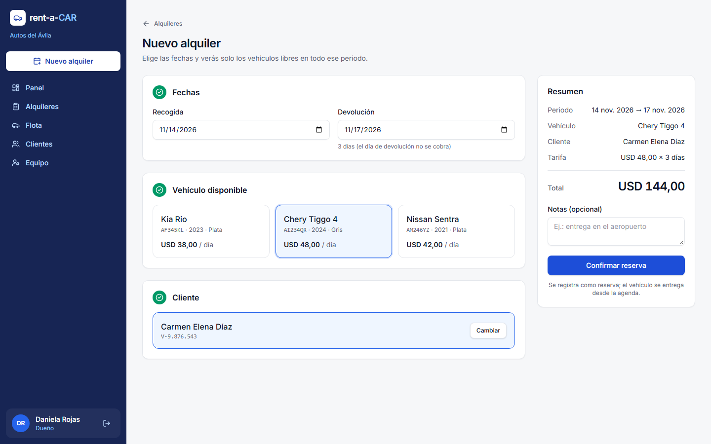
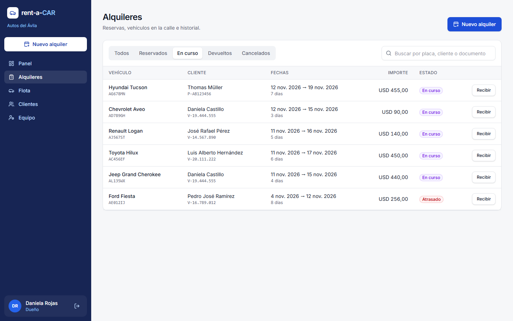
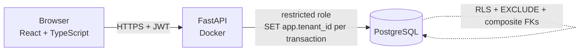

# rent-a-CAR

[](https://github.com/OWNER/rent-a-CAR/actions/workflows/ci.yml)


**Multi-tenant car rental management** — fleet, customers, bookings and business metrics for small rental agencies.
Double bookings are **impossible by design**: PostgreSQL rejects them atomically, even under concurrent requests.

🇪🇸 [Leer en español](README.es.md)


> **Try it locally in one command:** `docker compose up --build` → open http://localhost:8080 and click
> **“Demo como dueño”**. A demo agency with 6 months of history is created automatically.

---

## The problem

Small, independent rental agencies often run on notebooks, spreadsheets and WhatsApp. The most expensive
mistake in that setup is the **double booking**: promising the same car to two customers for overlapping dates.
This project makes that mistake impossible rather than merely unlikely, and gives the front desk a clear view of
what to hand over, what's due back, and what's overdue.

## Technical highlights

| Decision | Why it matters |
|---|---|
| **No-overlap guarantee lives in PostgreSQL** (`EXCLUDE USING gist` on a `daterange`) | Atomic. Neither two simultaneous requests nor an application bug can create a double booking. A test fires 8 concurrent requests and asserts exactly one wins. |
| **Multi-tenancy with Row Level Security** *plus* explicit filters in code | Two independent locks: if one fails, an agency still can't read another's data. The API connects with a restricted role, because superusers silently bypass RLS. |
| **Composite foreign keys** `(tenant_id, vehicle_id)` | A rental can't reference another agency's vehicle, by mistake or by attack. |
| **Pure domain rules** (`backend/app/domain/`) | Pricing, late fees and the rental state machine don't import the framework and are unit-tested in milliseconds. |
| **Money as `Decimal` end to end** | The API sends `"40.00"` as text; the frontend calculates in integer cents. No `0.1 + 0.2` surprises. |
| **Security by design** | Argon2id, short-lived JWT, role read from the DB on every request (deactivation is instant), login rate limiting, append-only audit log, no user enumeration on login. |
| **Honest engineering** | Every trade-off is documented with what was sacrificed. See [architecture & decisions](docs/01-arquitectura-y-decisiones.md) and [known technical debt](docs/04-roadmap.md#deuda-técnica-conocida). |

## Features

- **Dashboard** — vehicles available today, rentals in progress (with overdue alerts), pending pickups, monthly revenue, a 6-month revenue chart, and an agenda of upcoming pickups/returns with one-click actions.
- **New rental flow** — pick dates → see *only* vehicles free for the whole period → pick or create a customer → confirm. The total is computed live; if someone else books the car meanwhile, the API returns `409` and the list refreshes.
- **Rental lifecycle** — `reserved → active → returned` or `reserved → cancelled`, enforced by a state machine. A car can't be handed over before its start date; late returns are charged automatically.
- **Fleet & customers** — search, filters, pagination, create/edit; deleting is owner-only, and records with history can't be deleted (vehicles can be retired instead).
- **Fleet rules** — a vehicle with pending bookings can't be sent to maintenance; an unreturned (overdue) vehicle isn't offered as available.
- **Team** — the owner creates agents and can deactivate them; the deactivated user's open session stops working immediately.
- **Responsive, accessible UI** — keyboard-friendly native dialogs, labelled form fields, screen-reader table for the chart, works at phone width.

| | |
|---|---|
|  |  |
|  |  |

## Architecture



| Layer | Stack |
|---|---|
| Backend | Python 3.13, FastAPI, SQLAlchemy 2, Alembic, Pydantic v2, Argon2, PyJWT |
| Database | PostgreSQL 16: `EXCLUDE` constraints, Row Level Security, composite FKs, triggers |
| Frontend | React 19, TypeScript (strict), Vite, Tailwind CSS v4, TanStack Query, React Hook Form + Zod |
| Quality | pytest (unit + integration against real PostgreSQL), SQL schema tests, Vitest + Testing Library, Ruff, ESLint |
| Delivery | Docker (multi-stage, non-root), docker compose, GitHub Actions, Render blueprint |

```
rent-a-CAR/
├── backend/
│   ├── app/
│   │   ├── domain/          # pure business rules: pricing, state machine, periods
│   │   ├── routers/         # HTTP endpoints
│   │   ├── availability.py  # single definition of "is this car busy?"
│   │   ├── database.py      # connection + per-transaction tenant context for RLS
│   │   ├── seed.py          # demo agency with 6 months of data
│   │   └── …
│   ├── migrations/          # Alembic + hand-written SQL schema (single source of truth)
│   └── tests/               # unit tests + integration/ (real PostgreSQL) + sql/
├── frontend/src/
│   ├── pages/               # dashboard, new rental, rentals, fleet, customers, team, auth
│   ├── components/          # design-system primitives, layout, chart
│   ├── api/hooks.ts         # data access (TanStack Query)
│   └── lib/                 # API client, money in cents, timezone-safe dates
├── docs/                    # decisions, data model, deployment, roadmap
├── docker-compose.yml       # the whole stack, one command
└── render.yaml              # deployment as code
```

## Running it

### Everything with Docker (recommended)

```bash
docker compose up --build
```

| Service | URL |
|---|---|
| Web app | http://localhost:8080 — demo: `demo@rentacar.dev` / `demo-rentacar` (owner) or `agente@rentacar.dev` (agent) |
| API docs (Swagger) | http://localhost:8000/docs |
| PostgreSQL | `localhost:5433` (5433 to avoid clashing with a local PostgreSQL) |

### Development without Docker for the app

```bash
docker compose up -d db                      # just the database

cd backend
python -m venv .venv && source .venv/bin/activate   # Windows: .venv\Scripts\activate
pip install -r requirements.lock -r requirements-dev.txt
cp ../.env.example .env
alembic upgrade head && python -m app.seed
uvicorn app.main:app --reload

cd ../frontend
npm install
npm run dev                                  # http://localhost:5173
```

## Testing

| Suite | Command | What it covers |
|---|---|---|
| Backend unit + integration | `cd backend && pytest` | 66 tests. Integration tests create a **throwaway PostgreSQL database**, run the real Alembic migrations, and call the API through a **restricted DB role** so RLS is actually enforced. Includes the concurrency test, tenant isolation, roles, lifecycle, late fees, pagination, rate limiting. |
| SQL schema guarantees | `PGHOST=localhost PGPORT=5433 PGUSER=rentacar PGPASSWORD=rentacar bash scripts/test_schema.sh` | 12 checks run directly in SQL: overlaps rejected, back-to-back allowed, RLS read/write isolation, composite FKs, append-only audit log. |
| Frontend | `cd frontend && npm test` | Money in cents, timezone-safe dates, error translation, login form behavior. |
| Lint & types | `ruff check . && ruff format --check .` · `npm run lint && npm run typecheck` | Ruff includes security rules (bandit). TypeScript runs in strict mode. |

All of the above runs in **GitHub Actions** on every push, against a real PostgreSQL service. If the database
isn't reachable in CI, the integration tests fail rather than silently skip.

## API at a glance

| Resource | Endpoints | Who |
|---|---|---|
| Auth | `POST /auth/register`, `POST /auth/login`, `GET /auth/me` | public (rate-limited) / authenticated |
| Team | `GET/POST /users`, `POST /users/{id}/deactivate` | owner |
| Vehicles | `GET/POST /vehicles`, `GET /vehicles/available`, `GET/PATCH/DELETE /vehicles/{id}` | agent; delete: owner |
| Customers | `GET/POST /customers`, `GET/PATCH/DELETE /customers/{id}` | agent; delete: owner |
| Rentals | `GET/POST /rentals`, `GET /rentals/{id}`, `POST /rentals/{id}/status` | agent |
| Dashboard | `GET /dashboard/summary`, `/dashboard/agenda`, `/dashboard/revenue` | agent |
| Health | `GET /health`, `GET /health/db` | public |

Lists support `limit`/`offset` and return the total in the `X-Total-Count` header.

## Deployment

Free-tier deployment (Render + Neon/Supabase) is described step by step in
[docs/03-despliegue-gratuito.md](docs/03-despliegue-gratuito.md), including the two-role database setup that keeps
RLS effective in production. `render.yaml` defines both the API and the static web app.

## Documentation

1. [Architecture & decisions](docs/01-arquitectura-y-decisiones.md): every choice with its trade-off
2. [Data model](docs/02-modelo-de-datos.md)
3. [Free deployment](docs/03-despliegue-gratuito.md)
4. [Roadmap & known technical debt](docs/04-roadmap.md)

*Docs are written in Spanish; the code and API are in English.*
