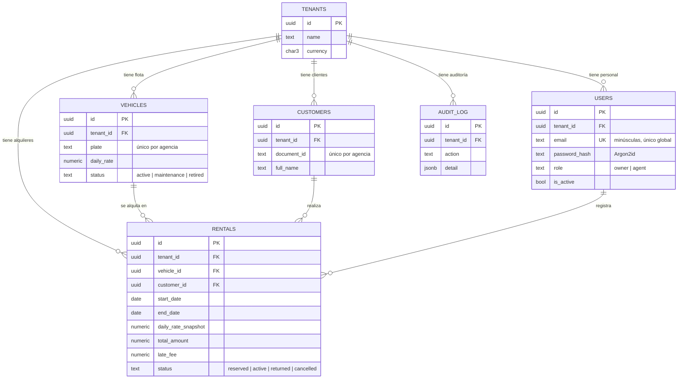

# 02 · Modelo de datos

El esquema completo está en [`backend/migrations/sql/0001_initial_schema.sql`](../backend/migrations/sql/0001_initial_schema.sql),
con comentarios explicativos. Aquí está la visión de conjunto.

## Diagrama entidad-relación



## Las tres garantías que hacen especial a este esquema

### 1. Anti-doble-reserva

```sql
CONSTRAINT rentals_no_overlap EXCLUDE USING gist (
    vehicle_id WITH =,
    daterange(start_date, end_date, '[)') WITH &&
) WHERE (status IN ('reserved', 'active'))
```

Se lee así: *"no puede haber dos filas con el mismo `vehicle_id` cuyos rangos de fechas se
crucen (`&&`), mirando solo las reservadas o activas"*. Es como una restricción `UNIQUE`, pero
para rangos. Detalles:

- `'[)'` = incluye el inicio, excluye el fin → el día de devolución queda libre.
- La cláusula `WHERE` deja fuera `returned` y `cancelled`, así que **liberan el vehículo**.
- Necesita la extensión `btree_gist` para poder mezclar `=` y `&&` en un solo índice.

### 2. Claves foráneas compuestas (aislamiento por construcción)

```sql
CONSTRAINT rentals_vehicle_fk FOREIGN KEY (tenant_id, vehicle_id)
    REFERENCES vehicles (tenant_id, id)
```

La reserva no apunta solo a "un vehículo": apunta al par *(esta agencia, este vehículo)*. Si la
agencia B intenta reservar un vehículo de A, el par no existe y PostgreSQL lo rechaza. Para
que esto sea posible, `vehicles` declara `UNIQUE (tenant_id, id)`, que parece redundante con
la clave primaria pero es lo que permite la referencia compuesta.

### 3. Row Level Security

```sql
CREATE POLICY tenant_isolation ON vehicles
    USING (tenant_id = app_tenant_id()) WITH CHECK (tenant_id = app_tenant_id());
```

`USING` decide qué filas se pueden **ver, modificar o borrar**; `WITH CHECK`, qué filas se
pueden **insertar**. `app_tenant_id()` lee la variable `app.tenant_id` que la API fija al
inicio de cada transacción (ver `app/database.py`). **Sin esa variable no se ve ninguna fila**:
el sistema falla "cerrado", no "abierto".

Dos políticas especiales:

- **`login_lookup`** (tabla `users`): al iniciar sesión aún no se sabe la agencia. En lugar de
  abrir toda la tabla, la API declara el email buscado en `app.login_email` y la política deja
  ver **solo esa fila**.
- **`audit_log`**: solo tiene políticas de `SELECT` e `INSERT`. Con RLS activo, un comando sin
  política aplicable no ve ninguna fila, así que `UPDATE` y `DELETE` no pueden tocar nada: el
  registro de auditoría es solo-añadir.

## Qué prueba cada comprobación

Se ejecutan con `scripts/test_schema.sh`, con un rol sin privilegios especiales:

| # | Comprobación | Garantía |
|---|---|---|
| 2 | Reserva solapada (12–20 sobre 10–15) rechazada con `23P01` | anti-doble-reserva |
| 3 | Reserva 15–20 tras 10–15 aceptada | rango semiabierto |
| 4 | Cancelar libera el vehículo | cláusula `WHERE` de la restricción |
| 5 | `end_date <= start_date` rechazado | `CHECK` |
| 6 | Placa duplicada en la misma agencia rechazada | `UNIQUE (tenant_id, plate)` |
| 7 | Agencia B no ve datos de A | RLS (`USING`) |
| 8 | Agencia B no puede escribir filas a nombre de A | RLS (`WITH CHECK`) |
| 9 | Agencia B no puede reservar un vehículo de A | clave foránea compuesta |
| 10 | Sin contexto de agencia no se ve nada | fallo "cerrado" |
| 11 | El login solo expone la fila buscada | política `login_lookup` |
| 12 | `audit_log` no se puede editar ni borrar | políticas solo `SELECT`/`INSERT` |

## Cómo evolucionar el esquema

Crea `0002_<descripcion>.sql` (con su versión `_down`) y una migración
`versions/0002_….py` que copie el patrón de la 0001. Nunca edites una migración que ya se
haya aplicado en algún entorno.
